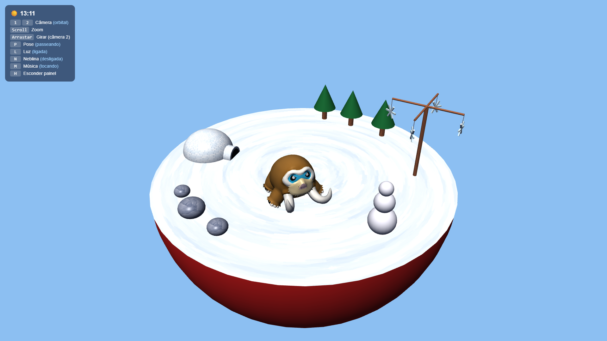
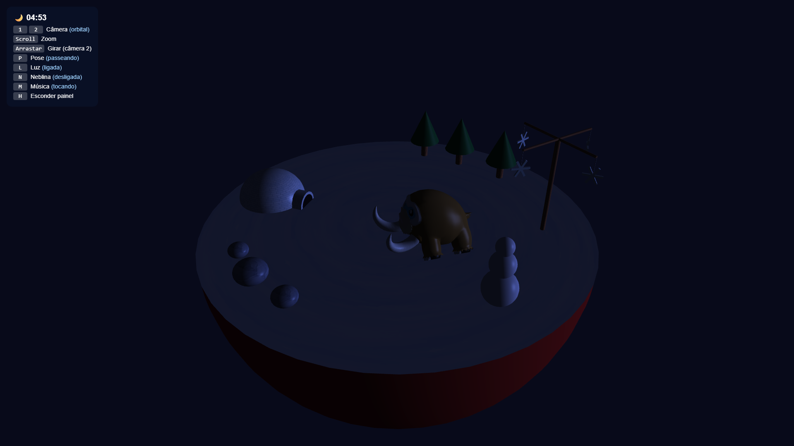
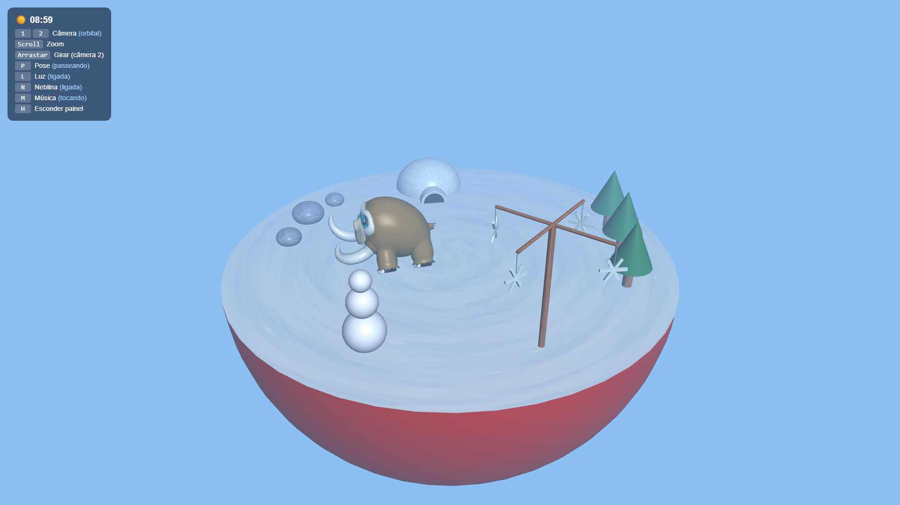

# Paraíso do Mamoswine

## (a) A Cena
Diorama 3D em WebGL2 de uma pokébola de inverno. Um Mamoswine vive numa ilha de neve com pinheiros, pedras, um boneco de neve, um iglu e um móbile de flocos girando. Ele passeia sozinho pela ilha enquanto o dia vira noite, com iluminação de Phong, neblina e a música de Snowbelle City.

**Veja aqui:** https://caiquepadua.github.io/utf-cg-tp2/

**Controles:**
- `1` / `2`: alterna entre a câmera automática (giro a 45°) e a câmera orbital
- Scroll: aproxima ou afasta a câmera
- Arrastar com o mouse: gira a câmera orbital
- `P`: alterna entre as 3 poses do Mamoswine (passeando, na borda e dormindo)
- `L`: liga e desliga a iluminação
- `N`: liga e desliga a neblina
- `M`: liga e desliga a música
- `H`: esconde e mostra o painel de controles

## (b) Criador(es)
Caíque Gomes de Pádua — contato: caiquegpadua@gmail.com

## (c) Media kit

## (d) Opcionais

- ⭐ **Modelos tridimensionais:** em vez de usar os sólidos próprios ou da TWGL.js, crie ou use modelos tridimensionais de terceiros e carregue-os no seu programa. Um formato simples é o .obj (mas ele não suporta animação). Tem também o formato glTF (mais complexo mas suporta animação)
  - *Implementado: carregador de .obj escrito do zero, com desindexação dos vértices, triangulação das faces e separação da geometria por material (`usemtl`), usado para o modelo do Mamoswine com texturas de corpo, olhos e boca.*

- 🌟 **Neblina:** funcionalidade acrescentada por comando do teclado (N), podendo ser habilitada e desabilitada durante a execução
  - *Implementado: neblina exponencial quadrática no fragment shader, na cor do céu, alternada pela tecla N.*

- 🍔 **Ciclo dia/noite:** faça o tempo passar e que isso defina na forma como o cenário é renderizado. Isso pode ser feito configurando-se a fonte de luz direcional com cores diferentes, dependendo da hora do dia
  - *Implementado: a direção do sol gira ao longo do tempo, e a cor da luz, a luz ambiente e a cor do céu interpolam entre dia e noite. Um relógio no painel mostra a hora da cena.*

- 🌟 **Música, efeitos sonoros e/ou som ambiente:** inclua música de fundo, sons ambiente e efeitos sonoros (este último, caso haja algum tipo de interação)
  - *Implementado: música de fundo em loop, iniciada pelo botão da tela de boas-vindas e controlada pela tecla M.*

- 💣 **Movimentação autônoma:** dê vida ao personagem fazendo-o andar pelo cenário. Deve haver uma máquina de estados com pelo menos as situações: (a) idle e (b) wandering. O personagem deve andar apenas por locais válidos
  - *Implementado: máquina de estados idle/wandering e um grafo de 7 pontos válidos no centro da ilha. Ao entrar em wandering, o Mamoswine sorteia um caminho de 1 a 3 arestas, vira na direção do movimento e anda com um quique e uma ginga que simulam os passos.*

**Extras:** tela de boas-vindas, painel com os controles e o estado de cada opção, e um iglu montado de forma hierárquica (cúpula, túnel e porta).

## (e) Créditos

- **Modelo do Mamoswine:** extraído de *Pokédex 3D Pro* (Nintendo 3DS), disponibilizado no The Models Resource — https://models.spriters-resource.com/3ds/pokedex3dpro/asset/338058/. Pokémon © Nintendo, Game Freak e The Pokémon Company.
- **Música:** "Snowbelle City", trilha de *Pokémon X e Y* — https://www.youtube.com/watch?v=ioGzCDxK8QU
- **Texturas (neve, casca de árvore, pedra e iglu):** geradas com inteligência artificial.
- **Biblioteca:** [TWGL.js](https://twgljs.org), de Gregg Tavares.